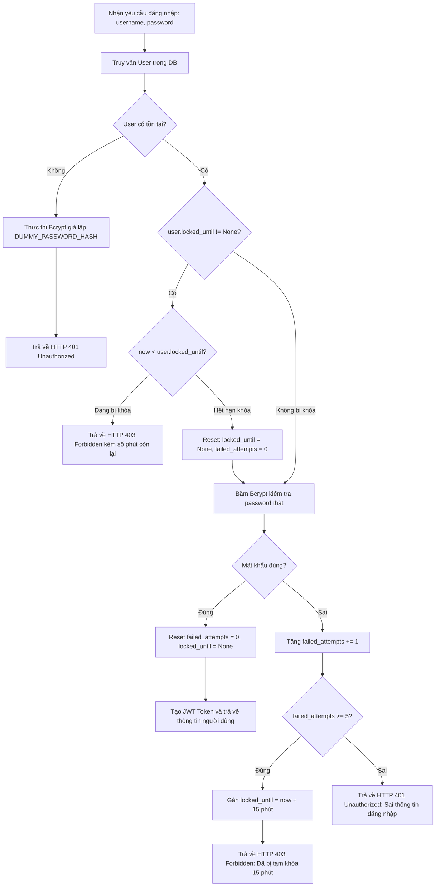

# CHƯƠNG 2: CHÍNH SÁCH MẬT KHẨU VÀ CÁC CƠ CHẾ PHÒNG THỦ BRUTE FORCE

## 2.1. Khái niệm và vai trò của chính sách mật khẩu (Password Policy)

Chính sách mật khẩu là tập hợp các quy tắc kỹ thuật được lập trình tại tầng ứng dụng nhằm áp đặt các ràng buộc bắt buộc trong suốt vòng đời của mật khẩu, từ khâu khởi tạo tài khoản, xác thực định kỳ đến thay đổi thông tin xác thực.

Một chính sách mật khẩu chuẩn mực thường bao gồm các tiêu chí:
- **Độ dài giới hạn**: Quy định độ dài tối thiểu (Minimum Length) và độ dài tối đa (Maximum Length).
- **Độ phức tạp của bộ ký tự (Character Complexity)**: Yêu cầu sự hiện diện đồng thời của nhiều nhóm ký tự khác nhau (chữ thường, chữ hoa, số, ký tự đặc biệt).
- **Danh sách đen (Blacklist / Dictionary Check)**: Từ chối các chuỗi mật khẩu phổ biến, mật khẩu mặc định của hệ thống, hoặc các chuỗi chứa thông tin cá nhân của người dùng (tên đăng nhập, email).
- **Cơ chế phản hồi khi vi phạm**: Cung cấp thông báo lỗi chi tiết, hướng dẫn người dùng sửa đổi thay vì chỉ báo lỗi chung chung.

### Tác động kỹ thuật của chính sách mật khẩu
1. **Mở rộng kích thước không gian khóa (Keyspace Expansion)**: Bằng cách ép buộc người dùng sử dụng độ dài lớn hơn và kết hợp nhiều nhóm ký tự, số lượng tổ hợp mà kẻ tấn công phải duyệt tăng lên theo hàm số mũ. Điều này làm cho việc vét cạn qua mạng trở nên bất khả thi về mặt thời gian và chi phí tính toán.
2. **Loại bỏ nguy cơ từ mật khẩu mặc định**: Rất nhiều vụ tấn công mạng xảy ra thành công do quản trị viên hoặc người dùng giữ nguyên mật khẩu mặc định khi cài đặt ứng dụng. Một chính sách kiểm tra độ mạnh tự động sẽ từ chối ngay lập tức các mật khẩu như `admin`, `admin123`, `123456`.
3. **Hình thành lớp phòng ngự cơ bản trong chiến lược Phòng thủ Chiều sâu (Defense-in-Depth)**: Mật khẩu mạnh đóng vai trò là rào chắn đầu tiên. Khi được kết hợp đồng bộ với cơ chế khóa tài khoản (Account Lockout), giới hạn tần suất (Rate Limiting) và thử thách CAPTCHA, hệ thống sẽ tạo thành một mô hình phòng vệ nhiều lớp, triệt tiêu gần như toàn bộ các kỹ thuật tấn công tự động.

---

## 2.2. Tiêu chuẩn mật khẩu mạnh và triển khai thực tế trong hệ thống

### 2.2.1. Yếu tố độ dài (Password Length)
Độ dài là yếu tố có tác động lớn nhất đến thời gian bẻ khóa của kẻ tấn công, vượt trội hơn so với việc chỉ tăng độ phức tạp của ký tự trên một chuỗi ngắn.

Giả sử kẻ tấn công thử nghiệm với tốc độ 1.000 phép thử/giây qua mạng nội bộ:
- Mật khẩu chỉ gồm chữ số ($C = 10$):
  - Độ dài 6 ký tự: $10^6 = 1.000.000$ tổ hợp $\rightarrow$ Vét cạn trong tối đa 1.000 giây (~16 phút).
  - Độ dài 8 ký tự: $10^8 = 100.000.000$ tổ hợp $\rightarrow$ Thời gian tăng lên 100.000 giây (~27,7 giờ).
- Mật khẩu kết hợp 4 nhóm ký tự ($C = 94$):
  - Độ dài 6 ký tự: $94^6 \approx 6{,}89 \times 10^{11}$ tổ hợp $\rightarrow$ Cần khoảng 21,8 năm.
  - Độ dài 8 ký tự: $94^8 \approx 6{,}09 \times 10^{15}$ tổ hợp $\rightarrow$ Cần hơn 193.000 năm.

Số liệu toán học trên chứng minh: việc tăng độ dài mật khẩu từ 6 lên tối thiểu 8 ký tự làm tăng độ an toàn của hệ thống lên hàng triệu lần.

### 2.2.2. Khuyến nghị của NIST SP 800-63B
Tiêu chuẩn **NIST Special Publication 800-63B (Digital Identity Guidelines)** đưa ra các định hướng hiện đại về quản lý mật khẩu:
- Bắt buộc độ dài tối thiểu ít nhất 8 ký tự cho người dùng phổ thông, và khuyến nghị từ 12 ký tự trở lên đối với các tài khoản đặc quyền (Administrator).
- Hỗ trợ độ dài tối đa lên tới ít nhất 64 ký tự (hệ thống trong đề tài hỗ trợ tới 100 ký tự) để người dùng có thể sử dụng các cụm mật khẩu dài (Passphrase).
- Loại bỏ các quy định bắt buộc đổi mật khẩu định kỳ 30 - 90 ngày nếu không có dấu hiệu lộ lọt, vì thực tế cho thấy quy định này phản tác dụng: người dùng sẽ có xu hướng chọn các mật khẩu có quy luật dễ đoán (ví dụ đổi từ `Password1!` sang `Password2!`).
- Cung cấp phản hồi trực quan thời gian thực (Real-time Feedback) trên giao diện để hướng dẫn người dùng đặt mật khẩu đạt chuẩn ngay từ bước nhập liệu.

### 2.2.3. Hiện thực hóa trong mã nguồn dự án

#### Phía Backend (`web/backend/app/schemas.py`)
Quy tắc kiểm tra độ mạnh của mật khẩu được đóng gói trong hàm `validate_password_strength()` và áp dụng trực tiếp vào mô hình Pydantic (`UserCreate`, `UserPasswordUpdate`):

```python
def validate_password_strength(v: str) -> str:
    if len(v) < 8:
        raise ValueError("Mật khẩu phải có tối thiểu 8 ký tự.")
    if not re.search(r"[a-z]", v):
        raise ValueError("Mật khẩu phải chứa ít nhất 1 chữ cái viết thường.")
    if not re.search(r"[A-Z]", v):
        raise ValueError("Mật khẩu phải chứa ít nhất 1 chữ cái viết hoa.")
    if not re.search(r"[0-9]", v):
        raise ValueError("Mật khẩu phải chứa ít nhất 1 chữ số.")
    if not re.search(r"[!@#$%^&*(),.?\":{}|<>]", v):
        raise ValueError("Mật khẩu phải chứa ít nhất 1 ký tự đặc biệt.")
    return v
```

Khi người dùng gửi mật khẩu không đạt yêu cầu, ngoại lệ `ValidationError` được hàm `extract_validation_error()` bắt giữ trong `app/routers/auth.py` và chuyển đổi thành mã trạng thái HTTP 400 Bad Request kèm thông báo lỗi tiếng Việt cụ thể, ngăn chặn lỗi máy chủ 500.

#### Phía Frontend (`web/frontend/src/components/PasswordStrengthMeter.tsx`)
Giao diện tích hợp component `PasswordStrengthMeter` đánh giá mật khẩu theo 5 tiêu chí:
1. Độ dài $\ge 8$ ký tự.
2. Có ít nhất 1 chữ thường (`a-z`).
3. Có ít nhất 1 chữ hoa (`A-Z`).
4. Có ít nhất 1 chữ số (`0-9`).
5. Có ít nhất 1 ký tự đặc biệt (`!@#$...`).

Thanh đo hiển thị 5 cấp độ trực quan:
- Thỏa mãn $\le 2$ tiêu chí: **Rất yếu** (Màu đỏ - `bg-red-500`).
- Thỏa mãn 3 tiêu chí: **Trung bình** (Màu vàng cam - `bg-amber-500`).
- Thỏa mãn 4 tiêu chí: **Khá** (Màu xanh dương - `bg-blue-500`).
- Thỏa mãn đủ 5 tiêu chí: **Mạnh (Đạt chuẩn chính sách)** (Màu xanh lục - `bg-emerald-500`).

---

## 2.3. Cơ chế Khóa tài khoản (Account Lockout Policy)

### 2.3.1. Nguyên lý vận hành
Account Lockout là giải pháp cốt lõi để chặn đứng kỹ thuật đoán mật khẩu liên tục. Cơ chế này theo dõi số lần đăng nhập thất bại liên tiếp của từng tài khoản. Khi số lần thử sai vượt quá một ngưỡng xác định, tài khoản sẽ chuyển sang trạng thái bị khóa tạm thời trong một khoảng thời gian định trước, từ chối mọi yêu cầu đăng nhập tiếp theo mà không cần kiểm tra mật khẩu.

### 2.3.2. Thuật toán xác thực trong dự án (`app/routers/auth.py`)
Quy trình xác thực được thực thi trong hàm `authenticate_user()` theo các bước sau:



### 2.3.3. Cấu hình tham số và lý do lựa chọn
- **Ngưỡng thử sai (`MAX_FAILED_ATTEMPTS = 5`)**: 5 lần là mức cân bằng chuẩn được khuyến nghị trong bảo mật ứng dụng web. Người dùng thực tế hiếm khi gõ nhầm mật khẩu quá 5 lần liên tiếp, trong khi đối với công cụ tấn công tự động cần thử hàng trăm hoặc hàng ngàn từ, 5 lần thử là con số quá nhỏ để đạt được kết quả.
- **Thời gian khóa (`LOCKOUT_DURATION_MINUTES = 15`)**: Khoảng thời gian 15 phút đủ dài để triệt tiêu hoàn toàn hiệu quả tốc độ của kẻ tấn công (nếu thử 1.000 mật khẩu thì mất tới hơn 50 giờ), nhưng cũng đủ ngắn để người dùng hợp lệ không phải chịu gián đoạn công việc quá lâu nếu vô tình nhập sai.
- **Mô hình dữ liệu trong CSDL (`app/models.py`)**:
  - `failed_login_attempts`: Kiểu số nguyên `Integer`, mặc định bằng `0`, tự động tăng khi nhập sai và tự động đặt lại về `0` khi nhập đúng.
  - `locked_until`: Kiểu thời gian `DateTime` (lưu trữ theo chuẩn UTC), lưu mốc thời gian hết hạn khóa. Khi tài khoản ở trạng thái bình thường, trường này nhận giá trị `None`.

### 2.3.4. Phân tích ưu điểm và nguy cơ Account Denial of Service (ADoS)
- **Ưu điểm**:
  - Ngăn chặn hoàn toàn việc gửi request đoán mật khẩu vô hạn trên một tài khoản.
  - Tự động mở khóa theo thời gian trôi qua, không làm phát sinh chi phí hỗ trợ kỹ thuật từ quản trị viên.
  - Bỏ qua bước băm mật khẩu Bcrypt khi tài khoản đang bị khóa, giúp máy chủ tiết kiệm tài nguyên CPU trong lúc bị tấn công dồn dập.
- **Nguy cơ Account Denial of Service (ADoS)**:
  - Khi kẻ tấn công biết được tên tài khoản của quản trị viên (`admin`), chúng có thể cố tình gửi 5 request sai liên tiếp để khóa tài khoản đó, ngăn cản quản trị viên thật đăng nhập vào hệ thống.
  - **Giải pháp xử lý triệt để**: Không áp dụng Account Lockout một cách đơn độc, mà phải kết hợp chặt chẽ với Rate Limiting theo địa chỉ IP và mã kiểm tra CAPTCHA. Khi kẻ tấn công bị giới hạn tần suất gửi request và không thể giải CAPTCHA tự động, chúng sẽ không thể thực hiện hành vi quấy rối khóa tài khoản hàng loạt.

---

## 2.4. Các cơ chế phòng thủ chuyên sâu (Defense-in-Depth)

### 2.4.1. Giới hạn tần suất yêu cầu (Rate Limiting) trong `app/rate_limit.py`
Hệ thống sử dụng cơ chế cửa sổ trượt (Sliding Window Algorithm) để giám sát lưu lượng request dựa trên địa chỉ IP của client:
- **Cơ chế xác thực (`/api/auth/*`)**: Áp dụng hàm `auth_rate_limiter`, cho phép tối đa 5 yêu cầu xác thực trong vòng 15 phút (900 giây) trên mỗi địa chỉ IP. Vượt ngưỡng sẽ bị phản hồi mã lỗi `HTTP 429 Too Many Requests`.
- **API công khai (`/api/guestbook`)**: Áp dụng hàm `rate_limiter`, cho phép tối đa 10 yêu cầu trong vòng 60 giây trên mỗi IP.
- **Vá lỗ hổng giả mạo IP client qua hàm `get_client_ip()`**:
  Trong phiên bản ban đầu, hệ thống đọc trực tiếp header `X-Forwarded-For` từ client gửi lên và có backdoor bỏ qua giới hạn nếu gặp IP `testclient`. Trên phiên bản vá lỗi (`fix_policy`), backdoor này bị xóa bỏ hoàn toàn. Hàm `get_client_ip()` chỉ đọc IP kết nối trực tiếp từ socket (`request.client.host`), loại trừ nguy cơ kẻ tấn công dùng Burp Suite xoay vòng IP ảo để qua mặt bộ đếm.

```python
def get_client_ip(request: Request) -> str:
    trust_proxy = os.getenv("TRUST_PROXY_HEADERS", "False").lower() in ("true", "1", "t")
    if trust_proxy:
        forwarded = request.headers.get("X-Forwarded-For")
        if forwarded:
            return forwarded.split(",")[0].strip()
        real_ip = request.headers.get("X-Real-IP")
        if real_ip:
            return real_ip.strip()
    return request.client.host if request.client else "unknown_ip"
```

### 2.4.2. Cơ chế CAPTCHA toán học vector SVG trong `app/captcha.py`
Để vô hiệu hóa hoàn toàn các công cụ tấn công tự động (Burp Suite Intruder, Hydra, Script), hệ thống tự sinh mã kiểm tra người-máy CAPTCHA nội bộ:
- **Tự trị và không phụ thuộc bên thứ ba**: Sinh trực tiếp bằng thuật toán nội bộ của máy chủ, không sử dụng Google reCAPTCHA hay Cloudflare Turnstile, tránh các rủi ro nghẽn mạng quốc tế và theo dõi dữ liệu người dùng.
- **Thử thách toán học ngẫu nhiên**: Hàm `generate_math_challenge()` sinh ngẫu nhiên các phép tính số học (cộng, trừ, nhân đơn giản giữa 2 số).
- **Hình ảnh vector SVG chống quét máy**: Hàm `generate_captcha_svg()` vẽ hình ảnh dạng SVG với nền chuyển màu, 3 đường sóng cong ngẫu nhiên (`stroke-width=1.5`) và 18 điểm chấm nhiễu, cùng góc xoay nhẹ của chữ, gây khó khăn lớn cho các công cụ OCR cơ bản.
- **Bảo vệ đáp án bằng JWT Token phi trạng thái (Stateless Token)**:
  - Đáp án đúng được mã hóa thành JWT Token có chữ ký `HMAC-SHA256` bằng `SECRET_KEY` của máy chủ và thời gian sống ngắn (5 phút).
  - Khi client gửi đáp án, máy chủ giải mã token để đối chiếu. Giải pháp này hoàn toàn không cần lưu trữ session hay database cho CAPTCHA, giúp hệ thống mở rộng linh hoạt mà không tốn bộ nhớ RAM.

### 2.4.3. Phòng chống tấn công phân tích thời gian phản hồi (Timing Attack Mitigation)
Khi người dùng nhập một `username` không tồn tại, nếu hệ thống trả về lỗi ngay lập tức, thời gian phản hồi chỉ mất từ 1 - 5ms. Ngược lại, nếu `username` có tồn tại nhưng sai mật khẩu, hệ thống phải thực thi thuật toán Bcrypt nặng nề, khiến thời gian phản hồi kéo dài từ 150 - 250ms. Chênh lệch thời gian này cho phép kẻ tấn công thực hiện kỹ thuật trinh sát thời gian (Timing Attack) để dò quét toàn bộ danh sách tài khoản hợp lệ.

Để triệt tiêu kỹ thuật này, trong `app/routers/auth.py`, khi phát hiện `username` không tồn tại, máy chủ vẫn chủ động gọi hàm băm Bcrypt trên một chuỗi mật khẩu giả lập:
```python
DUMMY_PASSWORD_HASH = get_password_hash("dummy_constant_time_pass_for_timing_mitigation_2026")

# Trong hàm authenticate_user:
if not user:
    verify_password(password, DUMMY_PASSWORD_HASH)
    raise HTTPException(
        status_code=status.HTTP_401_UNAUTHORIZED,
        detail="Tên đăng nhập hoặc mật khẩu không đúng",
        headers={"WWW-Authenticate": "Bearer"},
    )
```
Cơ chế này giữ cho thời gian phản hồi luôn đồng nhất ở mức xấp xỉ 200ms cho mọi trường hợp sai thông tin, tước bỏ khả năng đo lường độ trễ của kẻ tấn công.