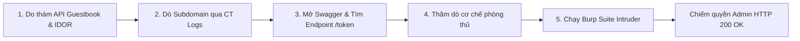

# CHƯƠNG 3: TRIỂN KHAI KỊCH BẢN TẤN CÔNG THỰC NGHIỆM

## 3.1. Thiết lập môi trường thử nghiệm

### 3.1.1. Kiến trúc hệ thống mục tiêu (Target System)
Hệ thống mục tiêu được đóng gói và vận hành dưới dạng các dịch vụ microservices độc lập thông qua Docker Compose:
- **Dịch vụ Giao diện người dùng (Frontend Web)**: Xây dựng trên nền tảng React 18, TypeScript, Tailwind CSS, Vite. Dịch vụ lắng nghe trên cổng nội bộ 8080, phục vụ trang cá nhân và ứng dụng Sổ lưu bút (Guestbook).
- **Dịch vụ Xử lý nghiệp vụ (Backend API)**: Xây dựng bằng Python FastAPI, lắng nghe trên cổng nội bộ 7000, tương tác với cơ sở dữ liệu SQLite (`guestbook.db`) qua SQLAlchemy ORM.
- **Hạ tầng Mạng & Định tuyến Public URL**: Thay vì thực nghiệm cục bộ trên địa chỉ `localhost`, toàn bộ hệ thống được công khai trực tiếp ra mạng Internet thông qua công nghệ **Tailscale Funnel / Serve** kết hợp 2 container proxy:
  - *Frontend Public URL*: `https://chat.taild6d848.ts.net/` (giao diện người dùng).
  - *Backend Public URL*: `https://chat-ts.taild6d848.ts.net/` (dịch vụ API độc lập).

Việc kiểm thử trên môi trường Internet có tên miền thật và chứng chỉ SSL/TLS từ Let's Encrypt giúp kết quả đo lường phản ánh chính xác các yếu tố thực tế như: độ trễ mạng (Network Round-Trip Time), cơ chế chuyển tiếp tiêu đề của Reverse Proxy, và tính thực tiễn của các công cụ kiểm thử bảo mật.

### 3.1.2. Bộ công cụ kiểm thử sử dụng trong đề tài
- **Burp Suite Community / Professional Edition**: Đóng vai trò là HTTP Proxy chặn bắt lưu lượng, biên tập gói tin (Repeater) và tự động hóa tấn công vét cạn theo từ điển (Intruder).
- **Công cụ điều tra nguồn mở OSINT (Certificate Transparency Logs)**: Sử dụng dịch vụ tra cứu nhật ký chứng chỉ trực tuyến tại `https://www.certkit.io/tools/ct-logs/` để dò quét các subdomain liên quan đến tên miền gốc của mục tiêu.
- **Trình duyệt Web & Developer Tools**: Sử dụng tab Network, Console và Application trên Google Chrome để kiểm tra tương tác API, phân tích gói tin JSON và các thuộc tính của Cookie.

---

## 3.2. Xây dựng danh sách từ điển mật khẩu (Wordlist)

Kẻ tấn công sử dụng tập tin từ điển `passwords.txt` gồm 64 mật khẩu phổ biến nhất được trích xuất từ các bộ từ điển chuẩn công nghiệp (như `SecLists` và `rockyou.txt`):

```text
123456
password
12345678
qwerty
123456789
12345
1234
111111
1234567
dragon
123123
baseball
abc123
football
monkey
letmein
shadow
master
654321
superman
1qaz2wsx
67890
michael
batman
trustno1
admin
admin123
administrator
root
toor
guest
demo
test
```

> **Ghi chú kỹ thuật:** Trong kịch bản thực nghiệm trên nhánh mã nguồn khởi điểm (`main`), tài khoản quản trị viên `admin` được cấp mật khẩu mặc định là `admin123`. Mật khẩu này được xếp ở vị trí thứ 27 trong tệp từ điển. Cách bố trí này giúp nhóm quan sát rõ ràng trạng thái gửi liên tiếp 26 yêu cầu thất bại của công cụ trước khi bắt được gói tin thành công ở lần thử thứ 27.

---

## 3.3. Các giai đoạn trong chuỗi tấn công (Attack Kill Chain)

Cuộc tấn công trên nhánh chưa vá lỗi (`main`) diễn ra tuần tự qua 4 bước:



### Bước 1: Do thám định danh và xác định mục tiêu (Reconnaissance)
1. Kẻ tấn công truy cập trang web `https://chat.taild6d848.ts.net/` dưới tư cách người dùng khách vãng lai.
2. Mở Công cụ nhà phát triển trình duyệt (F12) $\rightarrow$ Chuyển sang tab **Network**.
3. Khi tải danh sách lời nhắn trong ứng dụng Sổ lưu bút, trình duyệt gửi yêu cầu `GET /api/guestbook`.
4. Quan sát cấu trúc dữ liệu JSON trả về trong phản hồi:
   ```json
   [
     {
       "id": 1,
       "author_name": "admin",
       "author_role": "admin",
       "user_id": 1,
       "content": "Chào mừng bạn đến với Guestbook!"
     }
   ]
   ```
5. **Thông tin tình báo thu thập được**:
   - Hệ thống có cơ chế phân quyền vai trò (`author_role`).
   - Tồn tại tài khoản quản trị tối cao với định danh đăng nhập là **`admin`** (`user_id = 1`).
   - Kiểm tra thêm endpoint `GET /api/users/1` nhận thấy hệ thống không yêu cầu token xác thực, trả về toàn bộ thông tin tài khoản người dùng đầu tiên (lỗ hổng IDOR).
   - Kẻ tấn công xác định mục tiêu trọng tâm: Tấn công bẻ khóa tài khoản `admin`.

---

### Bước 2: Dò quét Subdomain ẩn và khai thác tài liệu Swagger UI
1. Trên giao diện frontend `https://chat.taild6d848.ts.net/`, kẻ tấn công thử mở đường dẫn `/docs` để đọc tài liệu API, nhưng nhận về phản hồi **HTTP 404 Not Found** (do Nginx reverse-proxy chỉ chuyển tiếp đường dẫn `/api`).
2. Tuy nhiên, trên giao diện đăng nhập web (`/api/auth/login`), dữ liệu được mã hóa client-side bằng giải thuật lai RSA-2048 và AES-GCM, gây khó khăn cho việc viết script vét cạn trực tiếp. Kẻ tấn công cần tìm một endpoint nhận mật khẩu dạng thô (Plaintext).
3. Kẻ tấn công sử dụng công cụ tra cứu **Certificate Transparency Logs (CT Logs)** tại `https://www.certkit.io/tools/ct-logs/` đối với tên miền gốc `taild6d848.ts.net`.
4. Do cơ quan cấp chứng chỉ (Let's Encrypt) bắt buộc công khai toàn bộ chứng chỉ SSL đã cấp phát vào sổ cái CT Logs toàn cầu, kẻ tấn công lập tức phát hiện ra subdomain backend độc lập:
   $$\mathbf{chat-ts.taild6d848.ts.net}$$
5. Kẻ tấn công truy cập trực tiếp `https://chat-ts.taild6d848.ts.net/docs` và mở ra toàn bộ giao diện **Swagger UI** của FastAPI do máy chủ chưa tắt cấu hình tài liệu trong môi trường triển khai thực tế.
6. **Phát hiện điểm yếu then chốt**: Tài liệu Swagger để lộ endpoint xác thực chuẩn OAuth2:
   $$\mathbf{POST\ /api/auth/token}$$
   Endpoint này nhận dữ liệu chuẩn `application/x-www-form-urlencoded` với 2 tham số thuần: `username` và `password`. Điều này cho phép kẻ tấn công gửi trực tiếp mật khẩu dưới dạng văn bản rõ mà không cần thực hiện mã hóa RSA trên client.

---

### Bước 3: Thăm dò cơ chế phòng vệ của hệ thống
Trước khi tung ra toàn bộ danh sách từ điển, kẻ tấn công thăm dò các rào cản kỹ thuật của cổng đăng nhập:
1. Gửi liên tiếp 5 - 10 request sai mật khẩu tới endpoint `POST /api/auth/token`.
2. **Hiện tượng ghi nhận**:
   - Máy chủ luôn trả về mã lỗi **HTTP 401 Unauthorized** kèm thông điệp: `"detail": "Tên đăng nhập hoặc mật khẩu không đúng"`.
   - Độ dài gói tin phản hồi là cố định (48 bytes).
   - Tài khoản `admin` không hề bị khóa, không xuất hiện mã lỗi HTTP 403, và không có bất kỳ khoảng trễ phản hồi nhân tạo nào.
3. **Thăm dò bộ đếm tần suất (Rate Limiting)**:
   - Khi gửi thử nghiệm với tần suất cao từ 1 địa chỉ IP, kẻ tấn công thử chèn tiêu đề HTTP giả lập client cục bộ:
     ```http
     X-Forwarded-For: testclient
     ```
   - Máy chủ chấp nhận tiêu đề này và bỏ qua hoàn toàn việc cộng dồn bộ đếm giới hạn request.
4. **Kết luận của kẻ tấn công**: Hệ thống trên nhánh `main` không có cơ chế Account Lockout, cơ chế Rate Limiting tồn tại backdoor bypass nghiêm trọng, và cổng đăng nhập không có CAPTCHA. Hệ thống hoàn toàn dễ bị tổn thương trước một cuộc tấn công vét cạn từ điển tự động.

---

### Bước 4: Thực hiện Tấn công Từ điển bằng Burp Suite Intruder
1. Kẻ tấn công cấu hình trình duyệt định tuyến qua Burp Suite Proxy (cổng `127.0.0.1:8080`).
2. Gửi một request đăng nhập mẫu tới `https://chat-ts.taild6d848.ts.net/api/auth/token` rồi chuyển gói tin sang module **Intruder** (`Ctrl + I`).
3. **Cấu hình Intruder**:
   - **Target**: Host `chat-ts.taild6d848.ts.net`, Port `443`, chọn Use HTTPS.
   - **Positions**: Chọn kiểu tấn công **Sniper**, đặt vị trí payload tại trường `password`:
     ```http
     POST /api/auth/token HTTP/1.1
     Host: chat-ts.taild6d848.ts.net
     User-Agent: Mozilla/5.0 (Windows NT 10.0; Win64; x64)
     X-Forwarded-For: testclient
     Content-Type: application/x-www-form-urlencoded
     Content-Length: 35

     username=admin&password=§password§
     ```
   - **Payloads**: Nạp toàn bộ danh sách từ tệp `passwords.txt`.
4. Bấm **Start Attack** và theo dõi diễn biến trên bảng kết quả.

---

## 3.4. Kết quả thực nghiệm tấn công trên nhánh `main`

### 3.4.1. Dữ liệu ghi nhận từ Burp Suite Intruder

Bảng tổng hợp trích xuất từ các request gửi đi:

| Request # | Payload (Mật khẩu thử) | HTTP Status Code | Content-Length (Bytes) | Diễn giải phản hồi từ máy chủ |
| :---: | :--- | :---: | :---: | :--- |
| 1 | `123456` | **401 Unauthorized** | 48 | Sai mật khẩu, từ chối cấp token |
| 2 | `password` | **401 Unauthorized** | 48 | Sai mật khẩu, từ chối cấp token |
| 3 | `12345678` | **401 Unauthorized** | 48 | Sai mật khẩu, từ chối cấp token |
| ... | ... | **401 Unauthorized** | 48 | ... |
| 25 | `trustno1` | **401 Unauthorized** | 48 | Sai mật khẩu, từ chối cấp token |
| 26 | `admin` | **401 Unauthorized** | 48 | Sai mật khẩu, từ chối cấp token |
| **27** | **`admin123`** | **200 OK** | **382** | **Mật khẩu chính xác! Cấp phát Access Token** |
| 28 | `administrator` | 401 Unauthorized | 48 | Tiếp tục gửi nếu không đặt điều kiện dừng |

### 3.4.2. Phân tích gói tin bẻ khóa thành công
Tại dòng thử thứ 27 với giá trị mật khẩu `admin123`:
1. **Mã trạng thái HTTP**: Đột ngột chuyển đổi từ chuỗi **401 Unauthorized** sang **200 OK**.
2. **Kích thước phản hồi**: Tăng vọt từ 48 bytes lên **382 bytes**.
3. **Tiêu đề phản hồi (Response Header)**: Máy chủ trả về tiêu đề `Set-Cookie` thiết lập cookie `access_token` chứa chuỗi JWT hợp lệ:
   ```http
   HTTP/1.1 200 OK
   Content-Type: application/json
   Set-Cookie: access_token=eyJhbGciOiJIUzI1NiIsInR5cCI6IkpXVCJ9...; Path=/; Secure; HttpOnly; SameSite=strict
   ```
4. **Nội dung phản hồi (Response Body)**: Máy chủ xác nhận phiên đăng nhập của tài khoản quản trị:
   ```json
   {
     "user": {
       "id": 1,
       "username": "admin",
       "role": "admin",
       "created_at": "2026-09-24T08:15:30",
       "display_name": null,
       "bio": null
     }
   }
   ```
5. Kẻ tấn công trích xuất token này nạp vào phiên làm việc của trình duyệt hoặc sử dụng trực tiếp trong các lệnh `curl` tiếp theo để thực hiện các thao tác quản trị viên: chỉnh sửa bài viết của người dùng khác, xóa dữ liệu trên hệ thống Sổ lưu bút, hoặc thay đổi cấu hình tài khoản.

### 3.4.3. Đánh giá nguyên nhân gốc rễ (Root Cause Analysis)
Cuộc tấn công từ điển đã chiếm quyền điều khiển tài khoản quản trị viên thành công chỉ sau **2,8 giây** với 27 yêu cầu gửi đi. Nguyên nhân trực tiếp dẫn tới sự cố bao gồm 4 yếu tố:
1. **Chính sách mật khẩu yếu**: Cho phép hệ thống tồn tại tài khoản đặc quyền sử dụng mật khẩu mặc định phổ biến (`admin123`).
2. **Thiếu vắng hoàn toàn cơ chế Account Lockout**: Hệ thống cho phép kẻ tấn công thử sai liên tục 26 lần mà không hề kích hoạt bất kỳ trạng thái khóa tài khoản hay làm chậm thời gian xử lý.
3. **Lỗ hổng logic trong Rate Limiting**: Bộ kiểm soát tần suất tin cậy tiêu đề do client tự tạo (`X-Forwarded-For: testclient`), làm tê liệt cơ chế bảo vệ theo địa chỉ IP.
4. **Không có thử thách kiểm định người-máy (CAPTCHA)**: Cổng đăng nhập cho phép các công cụ tự động gửi yêu cầu với tốc độ cao mà không có bất kỳ rào cản nào để phân biệt giữa người dùng thật và phần mềm tấn công.