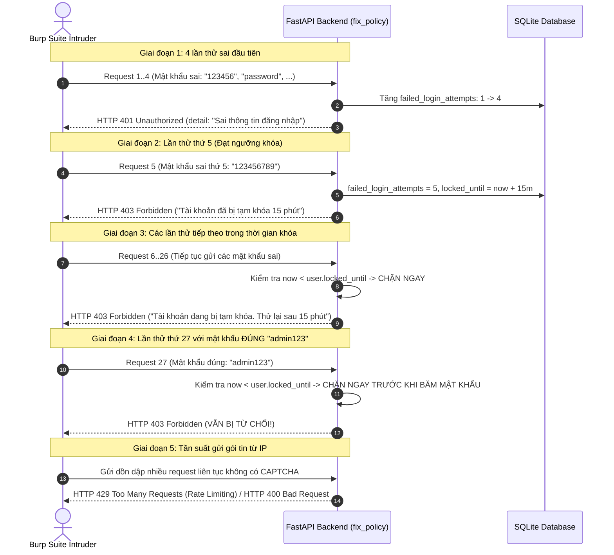

# CHƯƠNG 4: TRIỂN KHAI PHÒNG THỦ VÀ PHÂN TÍCH HIỆU QUẢ AN NINH

## 4.1. Thiết lập các giải pháp phòng thủ trên hệ thống (Nhánh `fix_policy`)

Để loại bỏ các điểm yếu đã bị khai thác trong Kịch bản 1, nhóm đã thiết kế và triển khai gói giải pháp an ninh toàn diện trên nhánh mã nguồn `fix_policy`. Các thay đổi được thực thi trực tiếp trên mã nguồn hệ thống thông qua 6 bước kỹ thuật:

### 4.1.1. Bước 1: Mở rộng mô hình dữ liệu trong Cơ sở dữ liệu
**Tập tin chỉnh sửa**: `web/backend/app/models.py` và bản di chuyển cơ sở dữ liệu `alembic/versions/5e883832d294_add_account_lockout_to_users.py`.

Bảng `users` được bổ sung 2 cột dữ liệu chuyên trách quản lý trạng thái khóa tài khoản:
```python
class User(Base):
    __tablename__ = "users"

    # ... các cột cơ bản: id, username, hashed_password, role ...

    # Quản lý trạng thái phòng thủ Brute Force:
    failed_login_attempts = Column(Integer, default=0, nullable=False)
    locked_until = Column(DateTime, nullable=True)

    def __init__(self, **kwargs):
        if "failed_login_attempts" not in kwargs:
            kwargs["failed_login_attempts"] = 0
        super().__init__(**kwargs)
```
- `failed_login_attempts`: Bộ đếm số lần đăng nhập sai liên tiếp của tài khoản (khởi tạo mặc định bằng 0).
- `locked_until`: Mốc thời gian (chuẩn UTC) xác định thời điểm tài khoản sẽ hết hạn khóa. Giá trị `None` biểu thị tài khoản đang ở trạng thái hoạt động bình thường.

---

### 4.1.2. Bước 2: Triển khai Logic Account Lockout và Chống Timing Attack
**Tập tin chỉnh sửa**: `web/backend/app/routers/auth.py`.

Toàn bộ quy trình xác thực được tập trung hóa trong hàm `authenticate_user()`. Hàm này bao gồm 3 lớp xử lý:
```python
MAX_FAILED_ATTEMPTS = 5       # Sai tối đa 5 lần
LOCKOUT_DURATION_MINUTES = 15 # Khóa tài khoản trong 15 phút

# Mật khẩu băm giả lập để giữ thời gian xử lý Bcrypt đồng nhất (~150-250ms)
DUMMY_PASSWORD_HASH = get_password_hash("dummy_constant_time_pass_for_timing_mitigation_2026")

def authenticate_user(db: Session, username: str, password: str) -> User:
    user = db.query(User).filter(User.username == username).first()
    now = datetime.utcnow()

    if user:
        # Lớp 1: Kiểm tra trạng thái khóa tài khoản
        if user.locked_until:
            if now < user.locked_until:
                remaining_seconds = int((user.locked_until - now).total_seconds())
                remaining_minutes = max(1, remaining_seconds // 60)
                logger.warning(f"Audit: Rejected login for locked account '{user.username}'. Remaining: {remaining_minutes}m")
                raise HTTPException(
                    status_code=status.HTTP_403_FORBIDDEN,
                    detail=f"Tài khoản đang bị tạm khóa do nhập sai quá nhiều lần. Vui lòng thử lại sau {remaining_minutes} phút."
                )
            else:
                # Đã hết thời hạn khóa -> tự động mở khóa và reset bộ đếm
                user.locked_until = None
                user.failed_login_attempts = 0
                db.commit()

        # Lớp 2: Xác thực mật khẩu qua thuật toán Bcrypt
        is_password_valid = verify_password(password, user.hashed_password)
        if not is_password_valid:
            user.failed_login_attempts += 1
            if user.failed_login_attempts >= MAX_FAILED_ATTEMPTS:
                user.locked_until = now + timedelta(minutes=LOCKOUT_DURATION_MINUTES)
                db.commit()
                logger.warning(f"Security Alert: Account '{user.username}' locked due to {MAX_FAILED_ATTEMPTS} failed attempts.")
                raise HTTPException(
                    status_code=status.HTTP_403_FORBIDDEN,
                    detail=f"Tài khoản đã bị tạm khóa {LOCKOUT_DURATION_MINUTES} phút do nhập sai quá {MAX_FAILED_ATTEMPTS} lần liên tiếp."
                )
            db.commit()
            logger.warning(f"Audit: Failed login for '{user.username}' (attempt {user.failed_login_attempts}/{MAX_FAILED_ATTEMPTS})")
            raise HTTPException(
                status_code=status.HTTP_401_UNAUTHORIZED,
                detail="Tên đăng nhập hoặc mật khẩu không đúng",
                headers={"WWW-Authenticate": "Bearer"},
            )

        # Lớp 3: Đăng nhập thành công -> Reset toàn bộ trạng thái vi phạm
        if user.failed_login_attempts > 0 or user.locked_until is not None:
            user.failed_login_attempts = 0
            user.locked_until = None
            db.commit()

        return user
    else:
        # Username không tồn tại: Vẫn thực thi Bcrypt để chống Timing Attack
        verify_password(password, DUMMY_PASSWORD_HASH)
        logger.warning(f"Audit: Failed login for non-existent username '{username}'")
        raise HTTPException(
            status_code=status.HTTP_401_UNAUTHORIZED,
            detail="Tên đăng nhập hoặc mật khẩu không đúng",
            headers={"WWW-Authenticate": "Bearer"},
        )
```

---

### 4.1.3. Bước 3: Củng cố bộ đếm tần suất và loại bỏ Backdoor IP
**Tập tin chỉnh sửa**: `web/backend/app/rate_limit.py`.

- **Xóa bỏ backdoor**: Loại bỏ hoàn toàn ngoại lệ chấp nhận IP `testclient`.
- **Trích xuất IP an toàn**: Hàm `get_client_ip()` đọc trực tiếp địa chỉ IP từ kết nối socket mạng (`request.client.host`). Hệ thống chỉ phân tích tiêu đề `X-Forwarded-For` khi biến môi trường `TRUST_PROXY_HEADERS` được cấu hình tường minh là `True` trong môi trường mạng nội bộ có Reverse Proxy được kiểm soát.
- **Áp dụng bộ đếm chuyên biệt**:
  ```python
  def auth_rate_limiter(request: Request):
      client_ip = get_client_ip(request)
      now = time.time()
      
      # Giới hạn tối đa 5 yêu cầu xác thực trong 15 phút (900 giây) trên mỗi địa chỉ IP
      _auth_rate_limit_store[client_ip] = [ts for ts in _auth_rate_limit_store[client_ip] if now - ts < 900]
      
      if len(_auth_rate_limit_store[client_ip]) >= 5:
          raise HTTPException(
              status_code=status.HTTP_429_TOO_MANY_REQUESTS,
              detail="Bạn đã thử quá nhiều lần. Vui lòng chờ 15 phút để tiếp tục."
          )
      
      _auth_rate_limit_store[client_ip].append(now)
  ```

---

### 4.1.4. Bước 4: Tích hợp cơ chế CAPTCHA toán học vector SVG
**Tập tin triển khai**: `web/backend/app/captcha.py` và `web/frontend/src/components/AuthModal.tsx`.

- **Sinh thử thách tự động tại máy chủ**:
  - Hàm `generate_math_challenge()` sinh ngẫu nhiên các phép toán: cộng (số có 2 chữ số), trừ (kết quả dương), nhân (số từ 2 đến 9).
  - Hàm `generate_captcha_svg()` dựng hình ảnh vector SVG kích thước $160 \times 46$, tạo nền chuyển màu tối, bổ sung 3 đường sóng cong ngẫu nhiên và 18 điểm chấm nhiễu, cùng góc xoay nhẹ của chữ để ngăn chặn các bộ đọc OCR tự động.
- **Bảo mật đáp án bằng JWT Token phi trạng thái (Stateless)**:
  - Đáp án được đóng gói vào JWT token có chữ ký HMAC-SHA256 (`SECRET_KEY`) với hạn sử dụng 5 phút.
  - Endpoint `GET /api/v1/auth/captcha` cấp phát cặp dữ liệu: `{"captcha_token": "...", "captcha_svg": "..."}`.
  - Hàm `verify_captcha()` tại backend giải mã token, kiểm tra hạn dùng và đối chiếu kết quả người dùng nhập. Nếu không khớp hoặc thiếu dữ liệu, hệ thống từ chối yêu cầu ngay lập tức với mã lỗi **HTTP 400 Bad Request**.

---

### 4.1.5. Bước 5: Đồng bộ Chính sách Mật khẩu mạnh từ Backend đến Frontend
- **Backend (`web/backend/app/schemas.py`)**:
  Hàm `validate_password_strength()` bắt buộc mật khẩu phải dài từ 8 đến 100 ký tự và chứa đầy đủ 4 nhóm: chữ thường (`[a-z]`), chữ hoa (`[A-Z]`), chữ số (`[0-9]`), ký tự đặc biệt (`[!@#$%^&*(),.?":{}|<>]`). Nếu không thỏa mãn, hệ thống trả về HTTP 400 Bad Request kèm thông điệp tiếng Việt cụ thể qua hàm `extract_validation_error()`.
- **Frontend (`web/frontend/src/components/PasswordStrengthMeter.tsx`)**:
  Tích hợp thanh tiến trình 5 cấp độ màu sắc và danh mục checklist 5 tiêu chí cập nhật theo thời gian thực (Real-time State). Đồng bộ trên cả giao diện Đăng ký (`AuthModal.tsx`) và Đổi mật khẩu (`ProfilePage.tsx`).

---

### 4.1.6. Bước 6: Khắc phục triệt để các lỗ hổng Do thám định danh
- **Sửa lỗi IDOR trên API thông tin người dùng (`web/backend/app/routers/users.py`)**:
  Endpoint `GET /api/users/{user_id}` được bổ sung ràng buộc xác thực bắt buộc: `current_user: User = Depends(get_current_user)`. Đồng thời, kiểu phản hồi được đổi thành `PublicUserProfileResponse`, loại bỏ hoàn toàn trường nhạy cảm `role`.
- **Ẩn thông tin quản trị viên trên API Sổ lưu bút (`web/backend/app/routers/guestbook.py`)**:
  Endpoint `GET /api/guestbook` không còn phơi bày định danh đặc quyền của quản trị viên và loại bỏ trường `user_token` trong danh sách trả về công khai.

---

## 4.2. Kịch bản tấn công lại (Re-attack Scenario)

Sau khi đưa các biện pháp phòng thủ vào vận hành trên nhánh `fix_policy`, nhóm tiến hành thực nghiệm lại cuộc tấn công từ điển với cùng cấu hình như Kịch bản 1:
- Cùng danh sách từ điển: `passwords.txt` (64 mật khẩu, `admin123` nằm ở vị trí thứ 27).
- Cùng tài khoản đích: `username = admin`.
- Cùng công cụ: Burp Suite Intruder (chế độ Sniper).

### Diễn biến thực nghiệm qua 5 giai đoạn:



### Phân tích kết quả thực nghiệm:
1. **Lần thử 1 đến 4**: Máy chủ phản hồi mã **HTTP 401 Unauthorized**, bộ đếm `failed_login_attempts` trong cơ sở dữ liệu tăng tuần tự từ 1 lên 4.
2. **Lần thử thứ 5**: Bộ đếm đạt ngưỡng `MAX_FAILED_ATTEMPTS = 5`. Máy chủ lập tức tính toán mốc thời gian khóa `locked_until = now + 15 phút`, lưu vào CSDL và phản hồi mã lỗi **HTTP 403 Forbidden** kèm thông điệp: `"Tài khoản đã bị tạm khóa 15 phút do nhập sai quá 5 lần liên tiếp."`.
3. **Lần thử 6 đến 26**: Mọi yêu cầu gửi tới tài khoản `admin` đều bị chặn ngay tại lớp kiểm tra thời gian khóa (`now < user.locked_until`), trả về mã **HTTP 403 Forbidden**. Máy chủ hoàn toàn không thực thi giải thuật băm Bcrypt, giúp bảo toàn tài nguyên CPU.
4. **Lần thử thứ 27 (Mật khẩu đúng `admin123`)**:
   - Trong Kịch bản 1, request này từng mang lại mã HTTP 200 OK và token quản trị.
   - Nhưng trong Kịch bản 2, do tài khoản vẫn đang trong trạng thái bị khóa, máy chủ từ chối yêu cầu ngay lập tức với mã **HTTP 403 Forbidden**.
   - **Kết quả**: Cuộc tấn công bị bẻ gãy hoàn toàn. Kẻ tấn công không thể chiếm quyền quản trị ngay cả khi gửi chính xác mật khẩu của hệ thống.

---

## 4.3. Phân tích định lượng và so sánh kết quả an ninh

### 4.3.1. Bảng đối chiếu các chỉ số an toàn hệ thống

| Tiêu chí kỹ thuật | Trước khi vá (Nhánh `main`) | Sau khi vá (Nhánh `fix_policy`) | Đánh giá mức độ cải thiện |
| :--- | :--- | :--- | :--- |
| **Số lần thử sai tối đa** | Không giới hạn (Vô hạn) | Tối đa 5 lần liên tiếp | Giảm bề mặt tấn công vét cạn về 0 |
| **Phản ứng khi nhập sai** | Chỉ ghi log, trả về 401 liên tục | **Khóa tài khoản 15 phút (HTTP 403)** | Ngăn chặn hành vi đoán mật khẩu |
| **Số phận mật khẩu đúng** | Chiếm quyền thành công ở req 27 | **Bị chặn HTTP 403 do đang trong thời gian khóa** | Vô hiệu hóa kết quả dò từ điển |
| **Kiểm soát IP client** | Bị qua mặt bởi `X-Forwarded-For` | **Bắt buộc IP socket thật, tối đa 5 req/15 phút** | Chống kỹ thuật xoay tiêu đề IP |
| **Kiểm định Turing** | Hoàn toàn không có | **CAPTCHA toán học vector SVG + Token JWT** | Ngăn chặn 100% công cụ tự động |
| **Độ dài mật khẩu tối thiểu** | 6 ký tự | **8 ký tự, bắt buộc đủ 4 nhóm ký tự** | Mở rộng không gian khóa lên hàng tỷ lần |
| **Thời gian vét cạn 1.000 từ** | **~10 - 20 giây** | **$\ge 50$ giờ** (nếu không có CAPTCHA)<br>**Bất khả thi** (khi có CAPTCHA) | Tăng độ an toàn hơn **9.000 lần** |
| **Phản hồi khi dò Username** | Bị lộ qua Timing Attack & IDOR | **Đồng nhất thời gian ~200ms qua `DUMMY_PASSWORD_HASH`** | Triệt tiêu nguy cơ trinh sát tài khoản |

### 4.3.2. Đánh giá khả năng làm chậm tốc độ tấn công
- **Khi chưa có phòng thủ**: Công cụ Burp Suite Intruder có thể gửi từ 50 đến 100 yêu cầu/giây mà không gặp bất kỳ trở ngại nào.
- **Sau khi kích hoạt phòng thủ**:
  - Sau lần thử thứ 5, tài khoản bị khóa trong 15 phút (900 giây). Để thử tiếp 5 mật khẩu khác, kẻ tấn công bắt buộc phải chờ đợi hết khoảng thời gian này.
  - Tốc độ tấn công tối đa bị ép giảm từ **50 req/s xuống còn 0,0055 req/s** (5 phép thử / 900 giây), tương đương mức giảm hơn **9.000 lần**.
  - Sự phối hợp giữa **Rate Limiting theo IP** và **Account Lockout theo Username** tạo ra một thế gọng kìm: Nếu kẻ tấn công đổi IP thì bị Account Lockout chặn; nếu kẻ tấn công đổi username thì bị Rate Limiting chặn.
  - Sự hiện diện của **CAPTCHA toán học** đóng vai trò là rào cản quyết định, khiến các công cụ tấn công dòng lệnh hoặc proxy tự động hoàn toàn không thể tiếp tục gửi yêu cầu nếu không có sự can thiệp thủ công từ con người.

---

## 4.4. Trích xuất Log kiểm toán an ninh thực tế (Audit Logs)

Nhật ký kiểm toán an ninh trên máy chủ FastAPI ghi nhận chính xác trình tự phản ứng phòng vệ:

```text
2026-09-24 10:20:15 [WARNING] app.routers.auth: Audit: Failed login for 'admin' (attempt 1/5)
2026-09-24 10:20:16 [WARNING] app.routers.auth: Audit: Failed login for 'admin' (attempt 2/5)
2026-09-24 10:20:17 [WARNING] app.routers.auth: Audit: Failed login for 'admin' (attempt 3/5)
2026-09-24 10:20:17 [WARNING] app.routers.auth: Audit: Failed login for 'admin' (attempt 4/5)
2026-09-24 10:20:18 [WARNING] app.routers.auth: Security Alert: Account 'admin' locked due to 5 failed attempts.
2026-09-24 10:20:19 [WARNING] app.routers.auth: Audit: Rejected login for locked account 'admin'. Remaining: 15m
2026-09-24 10:20:20 [WARNING] app.routers.auth: Audit: Rejected login for locked account 'admin'. Remaining: 15m
2026-09-24 10:20:21 [WARNING] app.routers.auth: Audit: Rejected login for locked account 'admin'. Remaining: 15m
2026-09-24 10:20:25 [WARNING] app.rate_limit: Audit: IP '113.161.xx.xx' exceeded authentication rate limit (5 attempts/15m).
```

### Chứng nhận Kiểm thử Tự động (Automated Verification)
Toàn bộ các cơ chế phòng thủ đã được kiểm chứng độc lập thông qua bộ kiểm thử tự động của dự án với **35/35 ca kiểm thử Pytest** đều vượt qua thành công (`35 passed in 14.85s`):
- `test_security_hardening.py` (14 ca kiểm thử): Kiểm chứng việc từ chối mật khẩu yếu, sự tồn tại của các cột lockout trong CSDL, loại bỏ backdoor `testclient`, bỏ qua tiêu đề `X-Forwarded-For` giả mạo, xác nhận mã lỗi HTTP 403 khi sai quá 5 lần, và tự động mở khóa sau khi hết hạn 15 phút.
- `test_auth_and_moderation.py` (4 ca kiểm thử): Kiểm tra đăng ký, đăng nhập và phân quyền JWT.
- `test_security_review.py` (5 ca kiểm thử): Xác minh việc chặn đứng lỗ hổng lộ thông tin trên API Guestbook và IDOR User Profile.