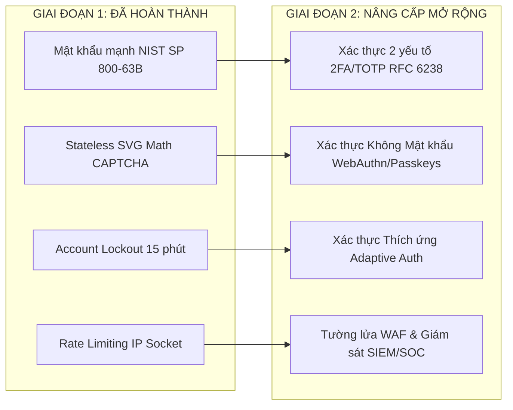

# CHƯƠNG 5: KẾT LUẬN VÀ HƯỚNG PHÁT TRIỂN

## 5.1. Tổng kết kết quả nghiên cứu và thực nghiệm

Thông qua quá trình nghiên cứu cơ sở lý thuyết, phân tích lỗ hổng kiến trúc và triển khai thực nghiệm trên môi trường mạng Internet thực tế, đề tài **"Kỹ thuật tấn công mạng: Tấn công Brute Force và Chính sách mật khẩu"** đã đạt được các kết quả cụ thể sau:

### 5.1.1. Về cơ sở lý thuyết và phương pháp luận
- Phân tích rõ cơ sở toán học của không gian khóa mật khẩu ($N = C^L$) và xác lập ranh giới kỹ thuật giữa hai hình thức: **Brute Force thuần túy** (vét cạn toàn bộ tổ hợp với chi phí bùng nổ theo hàm số mũ) và **Dictionary Attack** (tấn công từ điển dựa trên tập xác suất các mật khẩu phổ biến của con người).
- Hệ thống hóa các nguyên tắc quản lý thông tin xác thực hiện đại theo tiêu chuẩn **NIST SP 800-63B**, chỉ ra nguyên nhân khiến các quy định kiểm tra độ dài sơ sài ($\ge 6$ ký tự) biến cổng đăng nhập thành điểm yếu chí mạng của hệ thống.
- Làm rõ nguyên lý vận hành của các giải pháp phòng thủ tầng ứng dụng: giải thuật làm chậm Bcrypt kết hợp muối ngẫu nhiên (salt), cơ chế khóa tài khoản tự động (Account Lockout), thuật toán kiểm soát lưu lượng trượt (Rate Limiting), phép thử nhận thức người-máy (CAPTCHA), và kỹ thuật triệt tiêu trinh sát thời gian (Timing Attack Mitigation).

### 5.1.2. Về thực nghiệm tấn công (Kịch bản 1 - Nhánh `main`)
- **Triển khai môi trường mạng thực tế**: Hệ thống nạn nhân được công khai trực tiếp ra Internet thông qua mạng riêng ảo **Tailscale Funnel**, vận hành với tên miền thật (`https://chat.taild6d848.ts.net/` và `https://chat-ts.taild6d848.ts.net/`) kèm chứng chỉ mã hóa SSL/TLS hợp lệ từ Let's Encrypt.
- **Thực thi hoàn chỉnh chuỗi tấn công 4 giai đoạn**:
  1. *Do thám định danh*: Khai thác lỗ hổng lộ thông tin trên API `GET /api/guestbook` và lỗ hổng IDOR trên `GET /api/users/1` để xác định chính xác tài khoản quản trị tối cao: `username = admin` (`role = admin`, `user_id = 1`).
  2. *Dò quét hạ tầng ẩn*: Sử dụng công cụ tra cứu nhật ký chứng chỉ công khai **Certificate Transparency Logs (CT Logs)** tại `certkit.io` để phát hiện subdomain backend trực tiếp `chat-ts.taild6d848.ts.net`. Khai thác tài liệu **Swagger UI** tại `/docs` để tìm ra endpoint xác thực `POST /api/auth/token` nhận mật khẩu dạng văn bản rõ (bỏ qua lớp mã hóa RSA của giao diện web).
  3. *Thăm dò cơ chế bảo vệ*: Chứng minh hệ thống ban đầu hoàn toàn thiếu vắng cơ chế Account Lockout và cơ chế Rate Limiting tồn tại backdoor bypass nghiêm trọng qua tiêu đề `X-Forwarded-For: testclient`.
  4. *Khai thác từ điển tự động*: Cấu hình công cụ **Burp Suite Intruder** (chế độ Sniper), nạp tập từ điển `passwords.txt`. Tại yêu cầu thứ 27, công cụ đã bẻ khóa thành công mật khẩu mặc định `admin123`, nhận về mã trạng thái **HTTP 200 OK**, thu thập Cookie `access_token` JWT và chiếm toàn quyền quản trị hệ thống chỉ sau chưa đầy **3 giây**.

### 5.1.3. Về giải pháp phòng thủ và kiểm định kỹ thuật (Kịch bản 2 - Nhánh `fix_policy`)
Nhóm đã lập trình và tích hợp thành công mô hình Phòng thủ Chiều sâu (Defense-in-Depth) vào mã nguồn hệ thống:
1. **Account Lockout & Chống Timing Attack**:
   - Bổ sung 2 cột `failed_login_attempts` và `locked_until` vào bảng `users` qua bản di chuyển Alembic `5e883832d294`.
   - Giới hạn tối đa 5 lần nhập sai liên tiếp; nếu vượt ngưỡng, tài khoản lập tức bị khóa 15 phút với mã lỗi **HTTP 403 Forbidden**.
   - Bổ sung hàm băm giả lập hằng số thời gian `DUMMY_PASSWORD_HASH` trong `app/routers/auth.py` khi `username` không tồn tại, giữ thời gian phản hồi đồng nhất ~200ms để triệt tiêu kỹ thuật trinh sát tài khoản qua thời gian phản hồi (Timing Attack).
2. **Loại bỏ Backdoor & Thắt chặt Rate Limiting**:
   - Xóa bỏ hoàn toàn backdoor `testclient`.
   - Trích xuất địa chỉ IP trực tiếp từ kết nối socket mạng (`request.client.host`), giới hạn tối đa 5 yêu cầu trong 15 phút trên mỗi IP cho endpoint xác thực (phản hồi **HTTP 429 Too Many Requests** khi vượt ngưỡng).
3. **Tích hợp CAPTCHA toán học vector SVG nội bộ**:
   - Xây dựng module tự sinh CAPTCHA toán học dạng ảnh vector SVG trực tiếp tại máy chủ, không phụ thuộc dịch vụ bên ngoài.
   - Bảo mật đáp án bằng **Stateless JWT Token** có chữ ký HMAC-SHA256 với thời gian sống 5 phút, ngăn chặn việc tái sử dụng đáp án và bẻ gãy mọi công cụ quét tự động.
4. **Chuẩn hóa Chính sách Mật khẩu**:
   - *Backend*: Áp dụng bộ kiểm định Pydantic Validator bắt buộc mật khẩu dài $\ge 8$ ký tự, đủ 4 nhóm ký tự, trả về thông báo lỗi HTTP 400 thân thiện.
   - *Frontend*: Tích hợp thành phần `PasswordStrengthMeter` với thanh đo 5 mức màu và danh mục checklist 5 tiêu chí cập nhật theo thời gian thực trên cả form Đăng ký và Đổi mật khẩu.
5. **Khắc phục lỗ hổng do thám**:
   - Ẩn trường thông tin vai trò quản trị viên trên API Guestbook.
   - Bắt buộc xác thực trên API `GET /api/users/{user_id}`, trả về `PublicUserProfileResponse` không chứa trường `role`.
6. **Kiểm thử tự động hóa toàn diện**: Toàn bộ hệ thống đạt chứng nhận an toàn kỹ thuật với **35/35 ca kiểm thử Pytest** vượt qua thành công (`test_security_hardening.py`, `test_auth_and_moderation.py`, `test_security_review.py`).

---

## 5.2. Các hạn chế kỹ thuật của đề tài

Dù đã chứng minh rõ nét hiệu quả ngăn chặn tấn công trên thực nghiệm, đề tài vẫn ghi nhận một số hạn chế mang tính khách quan và phạm vi nghiên cứu:

1. **Phạm vi thử nghiệm mới dừng ở mô hình nguồn đơn lẻ (Single-source Attack)**:
   - Thử nghiệm tấn công từ điển trong đề tài được tiến hành từ một địa chỉ IP duy nhất (hoặc sử dụng tiêu đề giả mạo trên một kết nối).
   - Đề tài chưa kiểm nghiệm kịch bản **Tấn công Brute Force Phân tán (Distributed Brute Force / Botnet-based Attack)**: Trong thực tế, kẻ tấn công chuyên nghiệp có thể huy động mạng lưới hàng ngàn proxy xoay vòng (Rotating Residential Proxies) hoặc mạng Tor. Khi đó, mỗi IP chỉ gửi đúng 1 request thử mật khẩu, khiến cơ chế Rate Limiting theo IP bị vô hiệu hóa hoàn toàn. Lúc này, gánh nặng bảo vệ sẽ phụ thuộc hoàn toàn vào cơ chế Account Lockout và CAPTCHA.

2. **Rủi ro Tấn công Từ chối Dịch vụ Tài khoản (Account Denial of Service - ADoS)**:
   - Bản chất của Account Lockout là vô hiệu hóa quyền truy cập của một tài khoản khi có 5 lần nhập sai liên tiếp.
   - Điều này tạo ra một điểm yếu ngược lại: Kẻ tấn công biết được tên tài khoản `admin` có thể chủ động gửi liên tục 5 request sai để khóa tài khoản đó, làm tê liệt hoạt động của người quản trị hợp pháp (Denial of Service) mà không cần bẻ khóa thành công mật khẩu.

3. **Tính tiếp cận của CAPTCHA và nguy cơ từ công nghệ Thị giác Máy tính (OCR)**:
   - Cơ chế CAPTCHA toán học hiện tại chỉ hiển thị dưới dạng hình ảnh vector SVG, chưa có giải pháp âm thanh (Audio CAPTCHA) hỗ trợ người khiếm thị theo các tiêu chuẩn tiếp cận web quốc tế (**WCAG 2.1**).
   - Dù ngăn chặn tốt các công cụ quét tự động thông thường, hình ảnh vector SVG với các phép toán cơ bản vẫn có khả năng bị các mô hình thị giác máy tính tích hợp OCR hoặc mô hình ngôn ngữ đa phương thức (Multimodal AI) nhận diện và giải tự động nếu kẻ tấn công đầu tư viết script bóc tách ảnh.

4. **Chưa có cơ chế người dùng tự mở khóa (Self-service Unlock Mechanism)**:
   - Khi tài khoản bị khóa 15 phút, người dùng hợp lệ buộc phải chờ hết thời gian quy định mới có thể thử lại, gây ảnh hưởng đến trải nghiệm người dùng (UX). Hệ thống chưa có tính năng gửi liên kết mở khóa tức thì hoặc mã xác thực tạm thời qua Email/SMS.

---

## 5.3. Hướng phát triển và mở rộng trong tương lai

Để nâng cao năng lực bảo vệ trước các mối đe dọa an ninh mạng ngày càng phức tạp, hệ thống cần được định hướng nâng cấp theo các giai đoạn sau:

### 5.3.1. Tích hợp Xác thực Đa Yếu Tố (Multi-Factor Authentication - 2FA / TOTP)
- Bổ sung lớp xác thực thứ hai độc lập hoàn toàn với mật khẩu dựa trên thuật toán mã khóa dùng một lần theo thời gian (**RFC 6238 TOTP**).
- Người dùng quét mã QR bằng các ứng dụng phổ biến trên điện thoại (Google Authenticator, Microsoft Authenticator). Ngay cả khi mật khẩu bị kẻ tấn công bẻ khóa hoặc lộ lọt, hệ thống vẫn an toàn tuyệt đối vì kẻ tấn công không sở hữu khóa bí mật vật lý lưu trữ trên thiết bị di động của người dùng.

### 5.3.2. Chuyển dịch sang Xác thực Không Mật Khẩu (Passwordless via FIDO2 / WebAuthn)
- Xu hướng an ninh mạng toàn cầu đang loại bỏ dần mật khẩu truyền thống để giải quyết triệt để nguy cơ Brute Force tại gốc rễ.
- Triển khai chuẩn **FIDO2 / WebAuthn (Passkeys)** cho phép người dùng đăng nhập bằng cặp khóa mật mã bất đối xứng (Public Key Cryptography) liên kết với phần cứng thiết bị: xác thực sinh trắc học vân tay (Touch ID / Windows Hello), nhận diện khuôn mặt (Face ID), hoặc khóa bảo mật vật lý (YubiKey). Khi không có mật khẩu nào được truyền trên đường truyền mạng hay lưu trong cơ sở dữ liệu, các phương thức tấn công vét cạn và từ điển đều trở nên vô hiệu.

### 5.3.3. Xác thực thích ứng dựa trên phân tích rủi ro (Adaptive / Risk-Based Authentication)
- Thay vì áp dụng quy tắc khóa cứng tài khoản cố định 15 phút cho mọi trường hợp, hệ thống sẽ thu thập các chỉ số ngữ cảnh đăng nhập (Contextual Signals):
  - Dải địa chỉ IP và vị trí địa lý của yêu cầu (Geo-IP Lookup).
  - Dấu vân tay thiết bị và trình duyệt (Device & Canvas Fingerprinting).
  - Tốc độ di chuyển bất thường giữa các lần đăng nhập (Impossible Travel Detection).
- Khi phát hiện một yêu cầu đăng nhập có rủi ro cao (đến từ quốc gia lạ hoặc thiết bị chưa từng sử dụng), hệ thống sẽ chủ động kích hoạt bước xác minh bổ sung (yêu cầu mã xác thực qua Email hoặc gửi SMS OTP) thay vì khóa ngay tài khoản, giúp hạn chế rủi ro tấn công từ chối dịch vụ tài khoản (ADoS).

### 5.3.4. Triển khai Tường lửa Ứng dụng Web (WAF) và Giám sát An ninh Tập trung (SIEM)
- **Tường lửa WAF (Cloudflare / ModSecurity / AWS WAF)**: Thiết lập WAF ở tầng biên mạng để nhận diện và lọc bỏ các luồng quét tự động, tấn công từ điển phân tán từ mạng botnet trước khi gói tin chạm đến máy chủ ứng dụng FastAPI.
- **Hệ thống Quản lý Sự kiện và An ninh Thông tin (SIEM)**: Đồng bộ hóa toàn bộ nhật ký kiểm toán hệ thống (`audit logs`) vào các nền tảng SIEM tập trung (như Wazuh, Elastic Security, Splunk). Các công cụ này cho phép thiết lập quy tắc tương quan sự kiện để phát hiện hành vi tấn công theo thời gian thực và tự động kích hoạt phản ứng phòng thủ (tự động đưa IP tấn công vào danh sách đen của tường lửa mạng).
